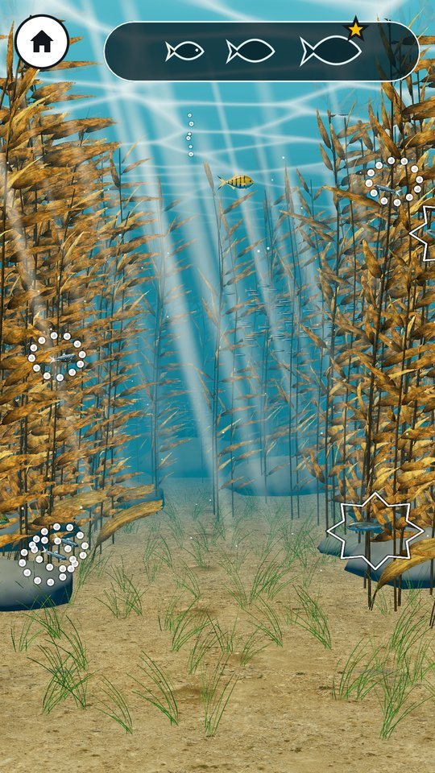
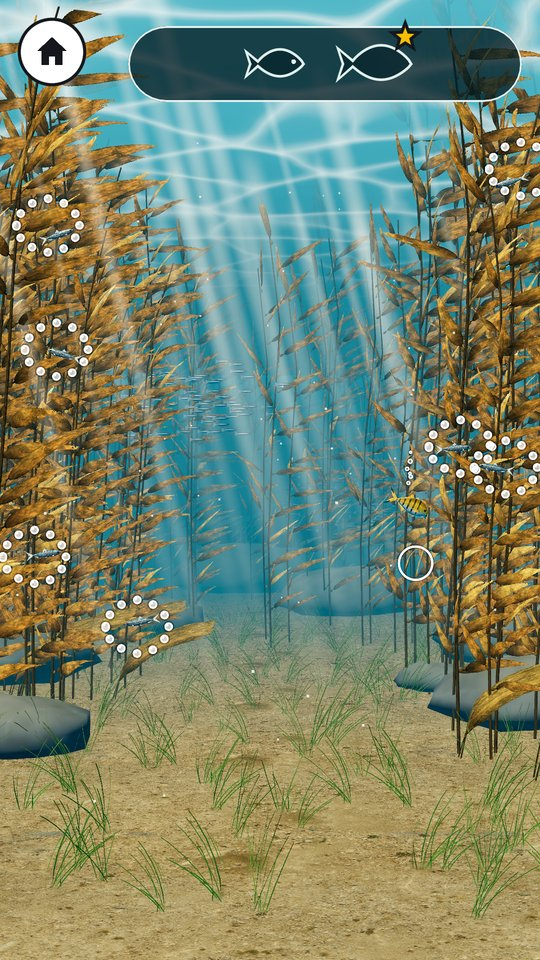
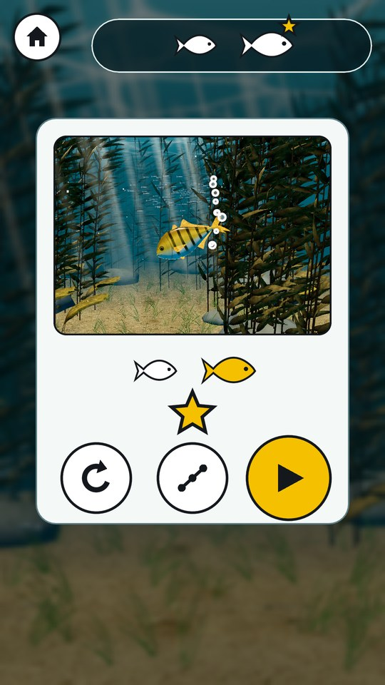

# MWM Reef Bite

An underwater eat-and-grow game for children on Android (ages 4-7 on the Lett setting, 8+ on Vanlig). You steer a small golden fish with one finger through a sunlit kelp forest, eat the fish that are smaller than you, keep away from the bigger ones and grow until you reach the level's goal. A big fish that catches you just burps you out in a bubble, so a small child never loses.

<p>
  
  
  
</p>

*Left to right: level 2 (bubble rings mark food, spiky rings mark danger), level 1 steering toward the aim ring, and the level 1 win card.*

## Download

**Android APK:** https://github.com/Matswm86/mwm-reef-bite/releases/download/latest/mwm-reef-bite.apk

- No ads, no tracking, no accounts, no network, no in-app purchases.
- Works offline. Asks for no Android permissions.
- Debug-signed sideload build (built by GitHub Actions on every push to `main`). Open the file and, if Android warns about the source, allow "Install from this source" (Install unknown apps) for the browser or file manager. Uninstall an older build first if the signature changed.

## What it does

**How to play:** hold a finger where you want to go and the fish glides there calmly, slowing down and settling under your finger. Touch a fish inside a bubble ring and your fish swims to it and eats it; keep away from the spiky ones.

World 1 "Tareskogen" (kelp forest), levels 1-5, in two settings:

| Level | Name | Goal (Lett / Vanlig) | New idea |
|---|---|---|---|
| 1 | Første munnfull | grow to size 3 / 4 | steer and eat, onboarding hand |
| 2 | Større fisker | grow to 4 / 5 | bigger fish and the danger cues |
| 3 | Bobla | grow to 4 / 5 | bubble shield power-up |
| 4 | Gjemmeleken | 4 / 6 pearls | kelp hiding places, pearl goal |
| 5 | Solstriper | grow to 4 / 5 | calm breather level |

How it plays:
- **Follow the finger:** hold a finger where you want to swim; the fish glides to a point a little above the fingertip (60 px on Lett, 120 px on Vanlig), eases in and settles there, and turns around smoothly. A finger within 160 px of a fish it can eat aims at that fish, so "touch the fish you want" works; it never aims at a bigger fish. Speeds are kept slow enough for a 4-year-old to follow (softer controls after the owner's phone test, 2026-10-10). A tap works too.
- **Size tiers:** every fish has a size 1-10. Smaller fish are food, bigger fish are danger, same-size fish just bump.
- **Four "can I eat it?" cues, none of them colour:** the size itself, your fish's mouth opens when food is in front of it, a smooth bubble ring around food and a spiky zigzag ring around danger, and danger fish open their mouths when close.
- **Gentle catch:** Lett costs nothing (burped out in a bubble). Vanlig empties the current size meter; world 1 has unlimited bubbles, so there is never a restart here.
- No text for the child, no score, no timer, no game over. One star per cleared level.
- Settings (gear on the map, stand-alone only): Lett / Vanlig, sound and music with volume sliders, "Mindre bevegelse" (less motion).

## How it works

The game is written in GDScript with static types on Godot 4.6.2 and exported to Android with the `mobile` renderer, portrait 1080x1920. The rules are a pure simulation with no scene nodes in it (steering, eating, catching, spawning, pearls, the bubble shield); a separate play layer reads touch input, runs the simulation and draws it. The picture is a real 3D kelp forest: all gameplay fish sit on one plane under a fixed perspective camera, so the size on screen is the size tier, and the fish and kelp are own-work models whose swim, jaw and fin motion run in vertex shaders. Sound effects and the music loop are synthesised by Python scripts in `tools/`, and progress and settings live in one small save file on the device. Inside the MWM Play family app the game runs in shell mode: the app's home button replaces the game's own, levels 1-3 are free and the full game is unlocked by the app.

## Status

Version 0.1.0, the world 1 vertical slice (levels 1-5 in Lett and Vanlig). Worlds 2-6 and the endless mode "Uendelig" are not built yet.

## For developers

Godot 4.6.2, GDScript with static types, `mobile` renderer, portrait 1080x1920. All gameplay fish sit on one plane under a fixed perspective camera, so the size on screen is the size tier. Rules: `docs/GDD.md`; look: `docs/DESIGN.md`; every tunable number: `scripts/RbBalance.gd`.

| Path | What |
|---|---|
| `scripts/RbSim.gd` | Pure game logic (no nodes): steering, eat / catch / bump, spawning, gentle catch, pearls, Bobla, kelp |
| `scripts/RbPlay.gd` | Touch input, drives the logic, fish views, rings, HUD, hand, sounds, win card |
| `scripts/RbWorld.gd` | The 3D kelp forest: camera, light, fog, floor, kelp MultiMesh, rays, surface, schools |
| `scripts/RbFishCatalog.gd` | Fish model name table: sculpted GLBs drop in by file name, else a procedural proxy |
| `scripts/RbState.gd` | Autoload `RbGame`: save file `user://reef_bite_save.json`, settings, MWM Play hooks and signals |
| `tools/render_sfx.py`, `tools/render_music.py` | Own-synthesis sound effects and the calm music loop |
| `tools/make_textures.py` | Caustic texture and app icon |

**Models.** The sculpted fish (`assets/models/fish/`, player `golden_trevally` plus tiers 1-7) and kelp (`assets/models/kelp/`) load by file name; their contracts are in the READMEs next to them. Fish names per tier live in `RbFishCatalog.SPECIES`; a tier without a GLB (8-10, not reached in world 1) falls back to a procedural proxy. The loader applies `shaders/rb_fish_glb*.gdshader` (swim, jaw, fin flare from the vertex-colour masks) and `rb_kelp_glb.gdshader` (current sway). Lav tier (32-bit devices): body and fins merged into one draw per fish, no normal maps. `RB_PROXY_FISH=1` forces the proxies; `godot --headless --audio-driver Dummy -s tests/glb_check.gd` load-checks every GLB.

Checks (run in the game folder, always with `--audio-driver Dummy`):

```bash
# Android lint: the studio's gd-android-lint.sh (a script outside this repo)
godot --headless --audio-driver Dummy --quit
XDG_DATA_HOME=<tmp> godot --headless --audio-driver Dummy res://tests/logic_test.tscn
XDG_DATA_HOME=<tmp> CAPTURE_DIR=<dir> godot --audio-driver Dummy --display-driver x11 \
  --resolution 1080x1920 res://tests/capture.tscn        # under Xvfb; CAPTURE_PHASE=shell for MWM Play mode
```

The logic test has a bot clear levels 1-5 in both settings and checks the rules (catches, bobler and the gentle restart, bump, spawn mix, chase, kelp, Bobla, pearls, save, sounds). Never build the APK locally; CI does it (`.github/workflows/build-android.yml`).

Credits and licences: `CREDITS.md`. The Godot licence and its third-party notices are on the settings panel ("Lisenser").
